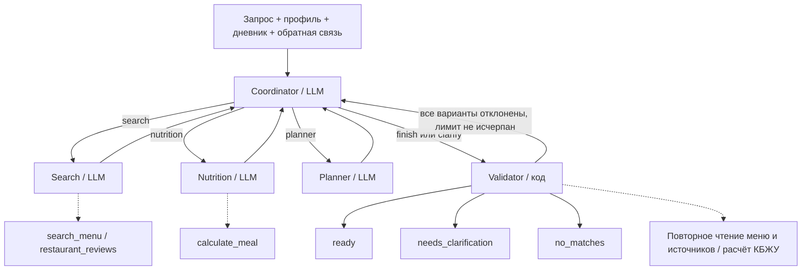

# Мультиагентные рекомендации

[Главная](../README.md) · [Архитектура](architecture.md) · [Модель данных](er.md) · [API и Swagger](api.md)

Сервис Recommendations использует LangGraph `StateGraph`: координатор выбирает следующую роль,
а три специалиста выполняют разные задачи с ограниченным набором инструментов.
Все LLM-роли используют одну настроенную модель через LangChain `ChatOpenAI`, но отдельные инструкции и контекст.
Программный Validator проверяет результат по данным сервисов перед выдачей пользователю.

| Роль | Решение и доступные действия |
| --- | --- |
| Coordinator | Уточняет ограничения из текста, выбирает специалиста, повторный поиск, завершение или вопрос пользователю. Возвращает типизированный `CoordinatorDecision`. |
| Search | Вызывает `search_menu` для поиска кандидатов; `restaurant_reviews` позволяет прочитать отзывы уже найденного ресторана. |
| Nutrition | Вызывает `calculate_meal` для одной порции каждого выбранного кандидата или группы до шести блюд; получает точные суммы и сведения о полноте данных. |
| Planner | Возвращает типизированный `MealPlan`: существующие ID блюд, целые порции и коды причин выбора. Учитывает предпочтения и результаты расчётов. |
| Validator | Повторно читает блюда, ресторан и источники, проверяет актуальность меню, ограничения и отсутствие дублей; пересчитывает стоимость и КБЖУ через Users & Nutrition. |

LLM интерпретирует запрос, выбирает инструменты и составляет варианты из найденных блюд.
Цены, нутриенты и источники берутся из сервисов. Каждый вариант содержит существующие блюда
одного ресторана, версии меню и валюты.

## Состояние и переходы

Общее состояние содержит запрос, профиль и дневные итоги, обязательные ограничения, найденных кандидатов,
результаты расчётов, план, причины отклонения и счётчики этапов. Оно передаётся между узлами графа.
Аллергии профиля нельзя ослабить запросом или решением модели; новые ограничения могут только ужесточать уже заданные.

Код обеспечивает порядок: поиск → расчёт → план. После каждого специалиста управление возвращается координатору.
Если все предложенные варианты отклонены и счётчик итераций меньше семи, Validator возвращает причины для повторного выбора.
При нехватке пользовательских данных результат содержит `needs_clarification`; ответ передаётся новым запросом
с `context_request_id`. Если подтверждённых подходящих вариантов нет, возвращается `no_matches`.

## Фоновое выполнение и трассировка

`POST /api/v1/recommendations` сохраняет задание в PostgreSQL и возвращает `202`, `Location` и `Retry-After: 2`.
Клиент читает результат через `GET /api/v1/recommendations/{id}`: `queued` → `running` → `completed` или `failed`.
Worker опрашивает очередь с интервалом одна секунда, выполняет граф и сохраняет результат и трассы в БД.
Промежуточное состояние графа находится в памяти; восстановленное задание проходит граф заново.
Остановка ожидания в iOS не отменяет серверное задание; повтор с тем же `Idempotency-Key` возвращает его же.

Admin-only trace хранит роль, статус, время, названия инструментов, ID источников, число токенов и краткий итог этапа.
Скрытые рассуждения модели, переписка с LLM, JWT и ключи API в трассу не записываются.

## Лимиты выполнения

| Ограничение | Значение |
| --- | --- |
| Выполнение одного задания | 600 секунд; после восьми решений координатора принудительный переход к Validator; `recursion_limit=40`. |
| Вызов LLM | Таймаут 90 секунд, один повтор SDK; по умолчанию `LLM_MAX_TOKENS=6000`. |
| Ответ модели | До двух попыток получить типизированное решение; у Search и Nutrition до четырёх раундов и четырёх выполняемых tool calls за раунд. |
| Поиск и итог | До 20 результатов за вызов поиска; 1–5 итоговых вариантов, до шести блюд в варианте, 1–20 порций блюда. |
| Очередь и восстановление | При двух активных заданиях пользователя новые отклоняются; heartbeat раз в 30 секунд, просроченное владение через 15 минут, до трёх попыток при восстановлении после сбоя worker. |

## Проактивная лента

Scheduler по умолчанию проверяет пользователей каждые 900 секунд (`PROACTIVE_INTERVAL_SECONDS`).
Подбор разрешён только при включённом `proactive_enabled`, с 11:00 до 20:59 в часовом поясе профиля,
не чаще одного задания на локальную календарную дату. Учитываются любимые кухни, бюджет и остаток дневного ориентира;
при известном неположительном остатке калорий задание пропускается.
Scheduler создаёт обычный `meal_plan` максимум с двумя вариантами через ту же очередь и граф.
Результат доступен в персональной ленте.

Реализация: [граф](../services/recommendations/graph.py), [очередь и scheduler](../services/recommendations/app.py),
[схемы результатов](../services/recommendations/schemas.py), [адаптер LLM](../services/recommendations/provider.py).
