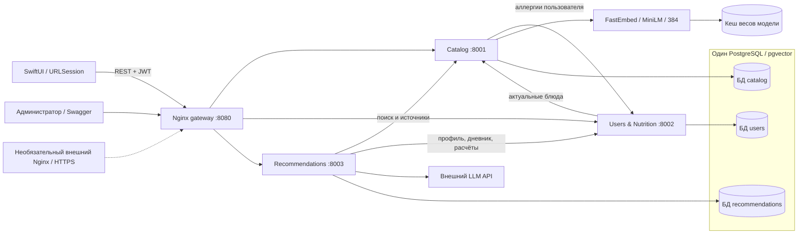

# Архитектура ГастроГида

[Главная](../README.md) · [Агенты](agents.md) · [Модель данных](er.md) · [API и Swagger](api.md)

ГастроГид объединяет поиск по меню нескольких ресторанов, персональные рекомендации и дневник питания.
Backend состоит из трёх FastAPI-сервисов; нативное приложение SwiftUI обращается к ним через единый Nginx gateway.
Docker Compose запускает сервисы, gateway и PostgreSQL с расширением pgvector.

| Компонент | Ответственность |
| --- | --- |
| Catalog | Рестораны, версии меню, импорт, источники, отзывы и семантический поиск. |
| Users & Nutrition | Учётные записи и JWT, предпочтения и аллергии, дневник, обратная связь, расчёт КБЖУ. |
| Recommendations | Граф агентов, фоновые задания, трассировка и персональная лента. |
| Nginx | Единые маршруты `/api/v1`, Swagger и проксирование OpenAPI трёх сервисов. |
| SwiftUI | Вход, профиль, каталог, подбор, лента и дневник; JWT хранится в Keychain. |

У каждого сервиса своя БД и роль PostgreSQL. Межсервисные ссылки проверяются через HTTP API;
между базами нет SQL JOIN и внешних ключей. Данные и кеш модели сохраняются в Docker volumes.
Профиль и пользовательские объекты доступны по JWT; административные методы требуют роли admin.
Внутренний метод получения контекста пользователей защищён `X-Internal-Token` и закрыт на gateway.

## От файла меню к поиску

1. Администратор загружает HTML, PDF или изображение. Исходный файл и задание сохраняются в БД.
2. Фоновый обработчик извлекает текст: BeautifulSoup для HTML, PyMuPDF для PDF,
   Tesseract `rus+eng` для фото и сканированных страниц. Лимиты: 20 MiB, 30 страниц PDF, 25 мегапикселей.
3. Черновик переходит в `needs_review`. Администратор проверяет позиции, состав, цены и источники,
   исправляет данные и публикует версию с проверкой номера ревизии.
4. До публикации рассчитываются эмбеддинги; предыдущая версия архивируется.
   Опубликованные версии и их источники сохраняются неизменными.

FastEmbed выполняет локальный ONNX inference модели `sentence-transformers/paraphrase-multilingual-MiniLM-L12-v2`.
Векторы блюд и отзывов имеют 384 измерения и хранятся в pgvector.
Поиск применяет обязательные ограничения, косинусное сходство и дополнительное ранжирование по словам названия и тегам.
Результаты содержат идентификаторы блюд и подтверждающих фрагментов: они становятся контекстом RAG для агентов.
Пока модель и индекс не готовы, поиск возвращает `503`.

## Правила данных

- Аллергии профиля добавляются к ограничениям запроса на сервере. Исключение аллергена требует
  явного `declared_absent` с источником; отсутствие сведений не считается подтверждением.
- Источники привязаны к ресторану и блюду. Отзывы помогают выбирать, но не подтверждают состав или КБЖУ.
- Неизвестные нутриенты остаются `null`; известные подытоги показываются отдельно.
  При обязательном ограничении на калории или белок неизвестное значение не проходит проверку.
- КБЖУ и стоимость рассчитывает сервис питания через `Decimal`. Цены хранятся в целых копейках;
  дневник сохраняет снимок блюда и допускает дробные съеденные порции.
- Создание рекомендации и записи дневника требует `Idempotency-Key`: одинаковый повтор не создаёт дубль,
  а повтор ключа с другим содержимым возвращает `409`.

Каталог рассчитан на один процесс/реплику. Стартовый набор содержит вымышленные данные:
пять ресторанов, 60 блюд и десять отзывов; КБЖУ помечены как оценки (`estimated`).
Внешний HTTPS-слой необязателен: для локального запуска достаточно основного Compose.
