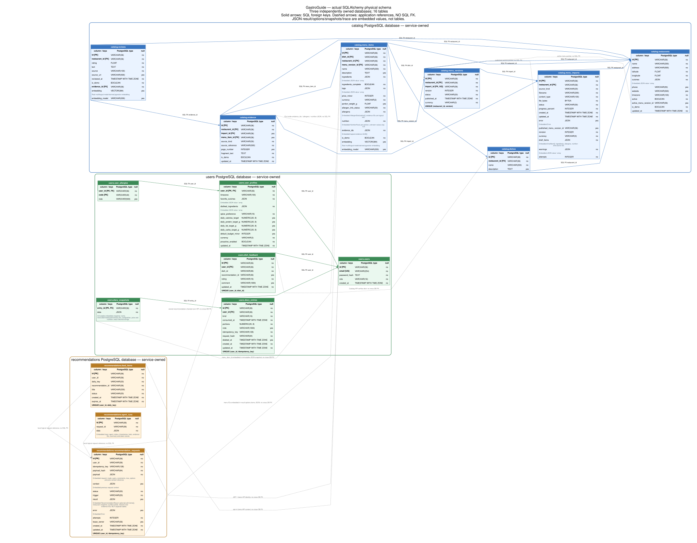

# Модель данных

В проекте три PostgreSQL-базы с отдельными сервисными пользователями. Диаграмма отражает **16 таблиц** из текущих SQLAlchemy-моделей.

[Открыть SVG целиком](er.svg).

| База | Сущности |
| --- | --- |
| Catalog | Рестораны, блюда, импорты, версии меню, позиции меню, источники и отзывы |
| Users | Пользователи, профили, аллергии, дневник, снимки данных и обратная связь |
| Recommendations | Задания, трассы агентов и персональная лента |

Сплошные стрелки — SQL foreign keys внутри базы; пунктирные — ссылки, которые проверяет приложение. Между сервисными базами SQL foreign keys отсутствуют: сервис обращается к владельцу данных по API.

Состав, аллергены, нутриенты, результаты рекомендаций и трассы содержат вложенный JSON. Это поля существующих таблиц. В меню и отзывах хранятся векторы `vector(384)`; исходные файлы импорта — в PostgreSQL.

Запись дневника хранит неизменяемый снимок блюда. Публикация нового меню не меняет ранее записанные цены и КБЖУ. День определяется часовым поясом профиля, время хранится в UTC.

SVG создаётся из моделей: после установки Python-зависимостей и Graphviz выполните `python scripts/render_er.py`. Архитектура взаимодействия сервисов описана [отдельно](architecture.md).
